<div align="center">


# CafeHop

**Discover and book Singapore's home cafes, all in one app.**

*"Hidden gems worth gatekeeping."*

[**Demo video**](https://youtu.be/VE6fTr64pMo) · [Features](#features) · [Screenshots](#screenshots) · [How it works](#how-it-works) · [Setup](#setup)

</div>

<table>
<tr>
<td width="40%" align="center">
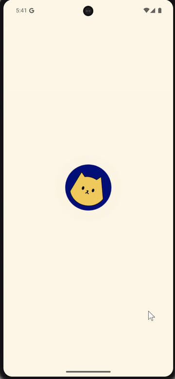
</td>
<td width="60%">

### At a glance

- **AI recommendations** from Groq Llama 3.1, based on each user's own saves, visits and reviews
- **Real bookings** in Cloud Firestore with live slot availability and double-booking checks
- **NETS QR deposits**, with the booking only created after payment is confirmed
- **OpenStreetMap** with live location, since home cafes are hard to find from an address
- **Local notifications** for reminders, visit check-ins and new AI picks
- **Photo reviews**, Google and phone sign-in, and 3 colour themes

</td>
</tr>
</table>

## The Problem

Home cafes are a growing part of Singapore's food scene, especially for Gen Z and young millennials who want authentic, community-driven experiences and like supporting home-based businesses. But finding and visiting one is a lot of work:

| Pain point | What happens today | CafeHop |
|---|---|---|
| **Discovery** | Scattered across TikTok, Instagram and word of mouth | One catalogue with search, categories and AI picks |
| **Menus and hours** | Spread across different websites and social pages | Every cafe page has its menu, hours and reviews |
| **Booking** | No standard system. You message the owner on Telegram or WhatsApp | Book a slot and pay the deposit in the app |
| **Getting there** | Many run out of HDB flats and landed houses with no signage | Built-in map with your live location |

All this effort leads to decision fatigue and can put people off home cafes entirely, which costs the cafes business. CafeHop puts the whole journey in one app, from finding a cafe to turning up.

## Screenshots

<table>
<tr>
<th colspan="4" align="left">Discover</th>
</tr>
<tr>
<td align="center" width="25%">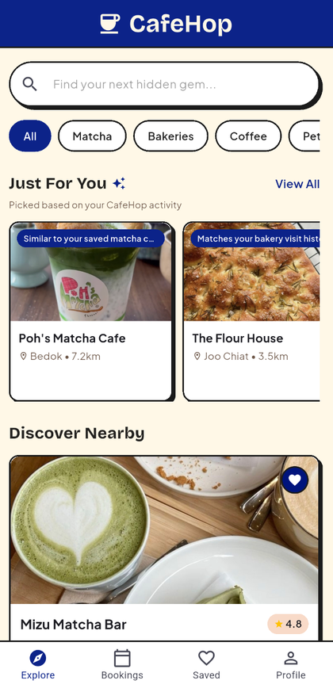<br><sub>Explore with Just For You</sub></td>
<td align="center" width="25%">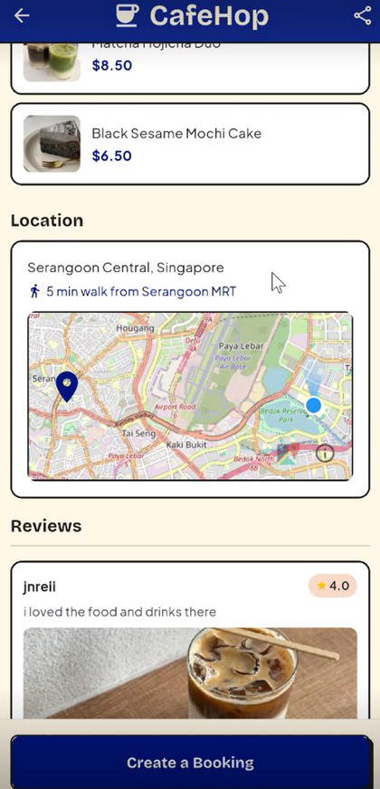<br><sub>Cafe page with map and reviews</sub></td>
<td align="center" width="25%">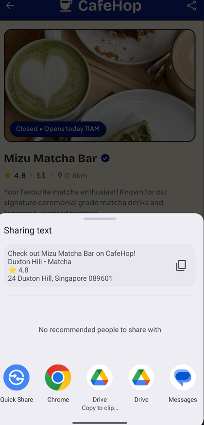<br><sub>Sharing a cafe</sub></td>
<td align="center" width="25%">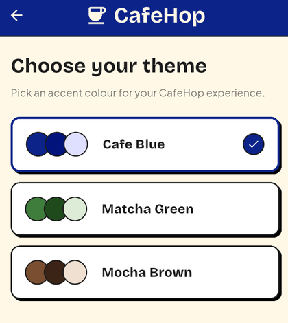<br><sub>3 colour themes</sub></td>
</tr>
<tr>
<th colspan="4" align="left">Book and pay</th>
</tr>
<tr>
<td align="center">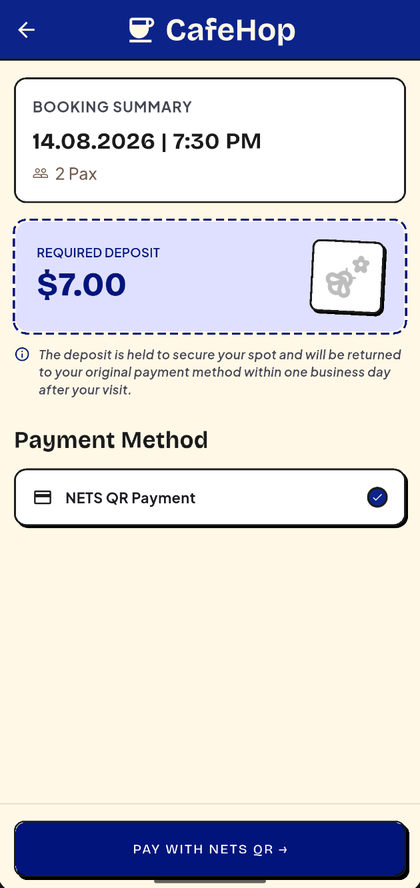<br><sub>Booking summary and $7 deposit</sub></td>
<td align="center">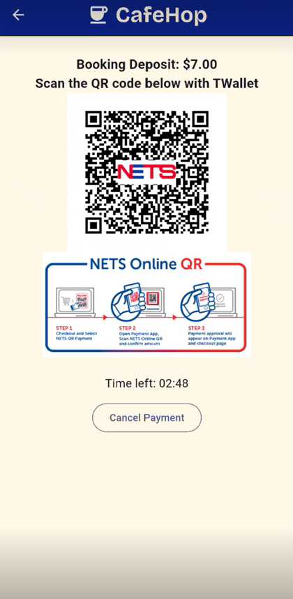<br><sub>NETS QR payment</sub></td>
<td align="center">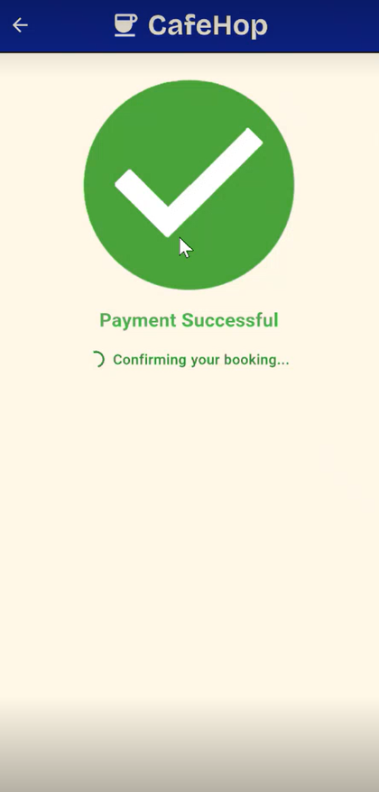<br><sub>Payment confirmed</sub></td>
<td align="center">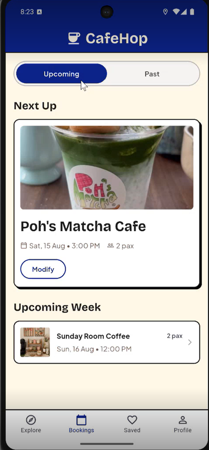<br><sub>Upcoming and past bookings</sub></td>
</tr>
<tr>
<th colspan="4" align="left">Before and after the visit</th>
</tr>
<tr>
<td align="center">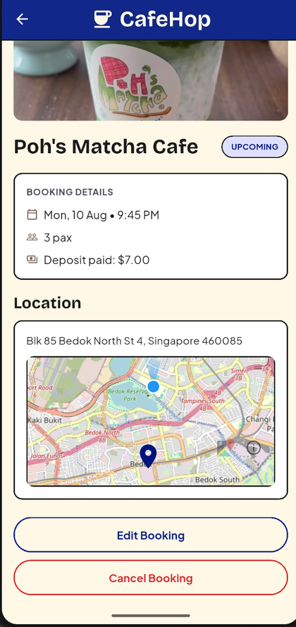<br><sub>Booking detail with map</sub></td>
<td align="center">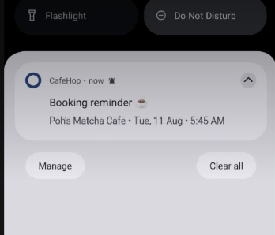<br><sub>Booking reminder</sub></td>
<td align="center">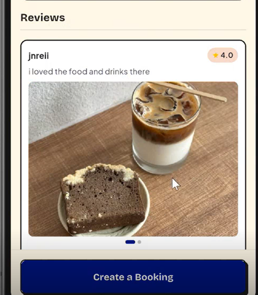<br><sub>Reviews with photos</sub></td>
<td></td>
</tr>
</table>

## Features

| Area | What it does | Built with |
|---|---|---|
| **AI recommendations** | Personalised "Just For You" picks with a short reason for each | Groq API, Llama 3.1 |
| **Bookings** | Create, view, edit and cancel table sessions | Cloud Firestore |
| **Payments** | $7 booking deposit through the NETS QR sandbox | NETS QR API |
| **Maps** | Cafe location with the user's live position | flutter_map, OpenStreetMap |
| **Notifications** | Booking reminders, visit check-ins, new AI picks | flutter_local_notifications |
| **Accounts** | Email, Google and phone sign-in, password reset, email verification | Firebase Auth |
| **Photos** | Camera or gallery photos on reviews and profiles | image_picker |
| **Personalisation** | Custom icon, animated splash, 3 saved colour themes | Lottie, SharedPreferences |

<details open>
<summary><b>AI Cafe Recommender</b></summary>
<br>

- **Signals:** saved cafes, completed visits and 4 to 5 star reviews. Completed visits and positive reviews count more than saves, and repeat visits to a category count more than one.
- **Ranked preference profile:** recalculated after each completed visit and saved to the user's Firestore document.
- **Short reasons** on every pick, like "Similar to your saved matcha cafes". The prompt bans generic reasons like "highly rated" and claims the app cannot back up, like "near you".
- **Hallucination guard:** any cafe ID the model invents, or repeats, is thrown away. Only real cafes from the catalogue are shown.
- **Fallbacks:** new users with no history get top-rated cafes without an API call. If Groq fails or returns too few picks, the gaps are filled with top-rated cafes, so the section is never empty.

</details>

<details>
<summary><b>Bookings</b></summary>
<br>

- Full create, read, update and delete for bookings.
- Only shows days the cafe is open in the next 14 days, and slots at least 30 minutes away.
- Hides slots that are already booked. When editing, your own slot stays selectable.
- Uses 5 kinds of Firestore query: field filters, `whereIn`, multi-field filters, sorting and server-side `count()`.
- Rechecks the slot one final time after payment and before the booking is created, to reduce the chance of a double booking.

</details>

<details>
<summary><b>NETS QR Payment</b></summary>
<br>

- A $7 deposit through the NETS QR sandbox, tied to a real reservation.
- Listens for live payment updates, with a 3 minute timer as a backup if the connection drops.
- Retries once on a network error before treating a check as failed.
- Rechecks the payment when the user comes back from the payment app, so a completed payment is not missed.

</details>

<details>
<summary><b>Maps, sharing and notifications</b></summary>
<br>

- **OpenStreetMap** with the user's live location on the cafe and booking pages. Free tiles, no API key or billing.
- **Sharing** through the phone's native share sheet.
- **Local notifications:** a reminder 24 hours before a booking, a prompt to confirm the visit afterwards, and an alert when a newly added cafe is picked by the AI recommender. A booking's notifications are cleared when it is changed or cancelled, and scheduled notifications follow the user's notification settings.

</details>

## How It Works

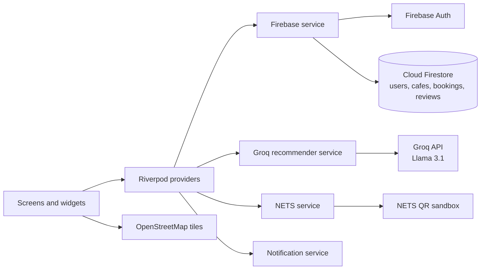

How a recommendation is made:

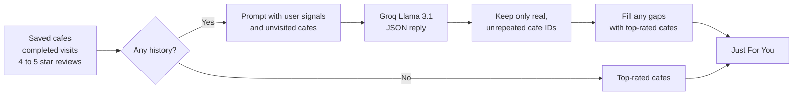

## Design Process

- I generated three visual concepts with Google Stitch and compared them: a cobalt blue indie style, a sage green premium style and a dark moody gold style.
- The final design uses the cobalt blue concept with a warm cream background, plus the booking form layout from the second concept and the map directions idea from the third.
- The booking form uses a horizontal date strip instead of a full calendar. Home cafes only open on certain days, and a calendar full of greyed-out dates would feel discouraging.
- Cafes are seeded into Firestore, and the app is built for guests. Bookings are the main data users create, edit and cancel.

## Project Structure

```
lib/
  models/      Cafe, Booking, Review, AppUser, Recommendation, NETS state
  services/    Firebase, Groq recommender, NETS, notifications, themes
  providers/   Riverpod providers
  screens/     Explore, cafe profile, booking flow, bookings, saved, profile, auth
  widgets/     Map, review card, NETS payment widgets, app bar
images/        cafe and menu photos, app icon, splash image
assets/        Lottie splash animation
```

## Setup

1. Install Flutter and run `flutter pub get`.
2. Connect your own Firebase project with `flutterfire configure`. This creates `lib/firebase_options.dart` and `android/app/google-services.json`, which are not included in this repo. Enable Email, Google and Phone sign-in, and Cloud Firestore.
3. Run the app with your keys passed in at build time:

```bash
flutter run --dart-define=GROQ_API_KEY=your_groq_key --dart-define=NETS_API_KEY=your_nets_key --dart-define=NETS_PROJECT_ID=your_nets_project_id
```

Without a Groq key, Just For You falls back to top-rated cafes and the rest of the app works normally.
